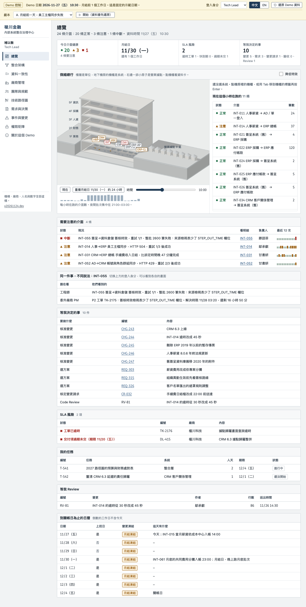

# 稜川金融 內部系統整合治理中心

應徵金融機構內部系統 Tech Lead 用的作品集 Demo，純前端。
它做成一套內部工具的樣子：ERP、CRM、人事薪資與簽呈系統之間的介面、對帳、廠商與變更，用同一份資料呈現給八種角色看。

線上版：https://tboydar.github.io/fin-internal-systems-hub/

**機構、廠商、產品、人名、工單、金額與事件全部虛構。** 沒有後端，沒有 API 金鑰，沒有追蹤碼，不呼叫任何外部服務。



## 有什麼

| 頁面          | 內容                                                                                        |
| ------------- | ------------------------------------------------------------------------------------------- |
| 總覽          | 介面健康、月結倒數、SLA 風險、等我決定的事；3D 微縮總行；每個角色看到自己的說法             |
| 整合架構      | 9 個系統、24 條介面的拓撲圖；欄位對應、重試與 DLQ、補償、對帳規則；「如果它停了」；API 目錄 |
| 資料一致性    | 10 條對帳規則與 SQL；差異點得到每一筆；一組查詢優化前後的執行計畫                           |
| 廠商管理      | SLA、交付、責任邊界（RACI）、合約里程碑、變更請求、違約與計罰試算                           |
| 團隊與規範    | 負載、技能矩陣與 bus factor、1:1 紀錄、文件庫、ADR、新人上手路徑                            |
| 技術路徑圖    | 2027 年四季的項目、相依、預算、人月、凍結期；財務版與工程版                                 |
| 需求與決策    | 需求流程、方案比較、決策紀錄                                                                |
| 事件與變更    | 事件流程與檢討、變更行事曆、不可逆變更的把關清單                                            |
| 權限矩陣      | 可編輯；職責分離檢查；稽核軌跡                                                              |
| 關於這個 Demo | 職缺要求對照表、三分鐘導覽、版號                                                            |

頁面最上面那一條是 **Demo 控制**，不屬於那套工具：切換登入身分、語言、劇本，或還原資料。

### 八個角色

| 角色         | 登入的人       | 看得到什麼                                      |
| ------------ | -------------- | ----------------------------------------------- |
| Tech Lead    | 褚以衡         | 全部；指派、核准變更、驗收、寫 1:1、做決策紀錄  |
| 內部工程師   | 鄔承叡         | 自己的任務、介面細節、Runbook、Code Review 佇列 |
| 委外廠商 PM  | 依選的廠商而定 | 只有自家系統的工單、SLA 與交付項                |
| 財務主管     | 鄺文琦         | 月結倒數、對帳差異、受影響的報表；沒有技術名詞  |
| 人資主管     | 池婉寧         | 到職、異動、薪資相關資料的狀態                  |
| 業務單位主管 | 卓承鈞         | CRM 需求進度與各據點狀態                        |
| 稽核         | 稽核室帳號     | 權限矩陣、稽核軌跡、變更紀錄；全部唯讀          |
| 系統管理員   | 系統管理員帳號 | 管理成員與權限矩陣                              |

### 三個劇本

從任何頁面都能啟動。劇本是一串改同一份狀態的步驟，所以所有頁面與 3D 場景會一起變。

- **A** 月結前一天，人事→ERP 員工主檔同步失敗：薪資分錄被保留、對帳出現差異、廠商工單開始計時、重送、檢討、留下 ADR 與路徑圖項目。
- **B** CRM 廠商交付延遲又被驗收退件：逾期計罰試算、責任邊界爭議、變更請求、決策紀錄。
- **C** 汰換舊簽呈系統：分階段切換、新舊並行對帳、切換日與回滾條件、寫進路徑圖。

三分鐘怎麼看：[`docs/demo-script.md`](docs/demo-script.md)。

## 怎麼跑

需要 [bun](https://bun.sh)。

```bash
bun install
bun run dev        # 開發伺服器，http://localhost:5173
bun run build      # 型別檢查 ＋ 正式建置，輸出到 dist/
bun run preview    # 預覽建置結果
```

## 怎麼測

```bash
bun run check                           # 型別檢查 ＋ lint ＋ 單元測試
bun run build && bun run check:bundle   # 首屏大小，以及 3D 與流程圖不進首屏
bun run build && bun run test:e2e       # 瀏覽器冒煙測試（會自己啟動預覽伺服器）
bun run check:names                     # 查假名稱有沒有跟真實公司或人物同名，約 5 分鐘
```

- **單元測試**（`tests/unit/`，`bun test`）守資料規則：固定種子的決定性、參照對得上、介面的廠商等於所屬系統的廠商、SLA 由工單算出、總覽的數字等於來源列數、凍結期避開國定假日、三個劇本走得完、3D 的模型等於 2D 算出來的結果。
- **冒煙測試**（`tests/e2e/`，Playwright）：八個角色登入後每一頁都開得起來、三個劇本從頭走到尾、數字點進去列數相同、重新整理不會 404、英文介面沒有殘留中文、瀏覽器只向網站本身拿靜態檔案、關掉 WebGL 其他功能照常。
- 本機的冒煙測試直接用已安裝的 Chrome。沒有的話先 `bunx playwright install chromium`，再用 `CI=1 bun run test:e2e`。
- 截圖：`bun run build && bun run preview --port 4173`，另開一個終端機跑 `bun scripts/screenshots.ts`，輸出到 `docs/screenshots/`（1280 寬）。

## 怎麼加一條介面

1. 在 `src/mock/ifaces.ts` 的 `SPECS` 加一筆：編號、來源與目的系統、所屬系統與廠商、協定、排程、欄位對應、補償做法。
2. `own` 的廠商必須等於所屬系統的廠商，否則 `tests/unit/mock.test.ts` 會失敗。
3. 經整合層的介面不用另外處理，拓撲圖會自動畫成兩段；3D 的小紙片也會自己出現。
4. 把 `src/mock/index.ts` 的 `STATE_VERSION` 加一，舊的 `localStorage` 會自動重建。
5. 跑 `bun run check`。執行紀錄會依排程與固定種子自動產生，不用手寫。測試裡寫死的「24 條」要跟著改。

要讓某個角色對這條介面有自己的說法，在 `src/core/narrative.ts` 加規則；沒加的話會用通用的句子。

## 設計決定寫在哪

[`docs/adr/`](docs/adr/)：

- [0001 純前端，沒有後端](docs/adr/0001-static-frontend-only.md)
- [0002 流程圖與 3D 做成延遲載入的島](docs/adr/0002-lazy-islands.md)
- [0003 假資料只有一個來源，畫面上的數字都是算出來的](docs/adr/0003-mock-data-consistency.md)
- [0004 3D 與 2D 讀同一份狀態](docs/adr/0004-shared-state-2d-3d.md)
- [0005 雙語文字就地寫成一對](docs/adr/0005-inline-bilingual-text.md)

分支、commit 與改資料的規則在 [`CONTRIBUTING.md`](CONTRIBUTING.md)。

## 資料夾

```
├── .github/                 CI（型別檢查、lint、測試、建置、大小檢查、冒煙測試、部署）與 PR 範本
├── docs/                    ADR、Demo 腳本、截圖
├── scripts/                 版號、名稱查核、大小檢查、截圖
├── tests/unit/              資料規則（bun test）
├── tests/e2e/               瀏覽器冒煙測試（Playwright）
└── src/
    ├── core/                型別、store、權限、雙語、日期、推導（selectors、sla、derive）、說法、劇本、3D 的模型
    ├── mock/                假資料，固定種子
    ├── ui/                  外殼、樣板與事件工具、圖示、共用元件、延遲載入
    ├── flow/                流程圖（xyflow 的 React 島）
    ├── three/               3D 場景
    ├── pages/               十個頁面，每頁一個 chunk
    └── styles/main.css      設計代碼與樣式
```

## 版號

每次建置帶一個版號 `v<台灣日期>.<當天第幾次 CI>`，例如 `v20261124.2`。
每個 commit 各自 push、各跑一次 CI，所以每個 commit 版號加一；失敗或被取消的那幾次也佔一個號碼，隔天從 1 開始。
顯示在每一頁的側欄底部與「關於這個 Demo」頁，也寫在 `index.html` 的 `<meta name="app-version">`：

```bash
curl -s https://tboydar.github.io/fin-internal-systems-hub/ | grep app-version
```

本機建置的版號是 `v<今天>.dev`。算法在 `scripts/app-version.ts`。

## 部署

推到 `main` 就會跑 `.github/workflows/deploy.yml`，任何一步失敗就不部署。
`vite.config.ts` 的 `base` 是相對路徑 `./`，路由用 hash（`#/overview`），所以 repo 改名或換子路徑都開得起來，重新整理也不會 404。

## 已知的限制

- 權限矩陣存在瀏覽器裡，是用來說明「誰該看到什麼」，不是安全機制。
- 3D 的時間軸拉到哪個小時沒有存下來，換頁再回來會回到「現在」。
- 各角色的說法只涵蓋寫了規則的情況；其餘用通用的句子。
- 英文版是作者自己寫的，沒有請母語人士校對。
- commit `ebfa687` 單獨拿出來型別檢查不會過（外殼檔少一行，下一個 commit 補上）。

## 資料出處

- 國定假日：行政院人事行政總處 115 年與 116 年「政府行政機關辦公日曆表」（data.gov.tw 資料集 14718，2026-11-23 查詢）。寫在 `src/core/date.ts`。
- 其餘內容都是為這個 Demo 編的。名稱的查核範圍與限制寫在 `scripts/check-names.ts` 開頭。
